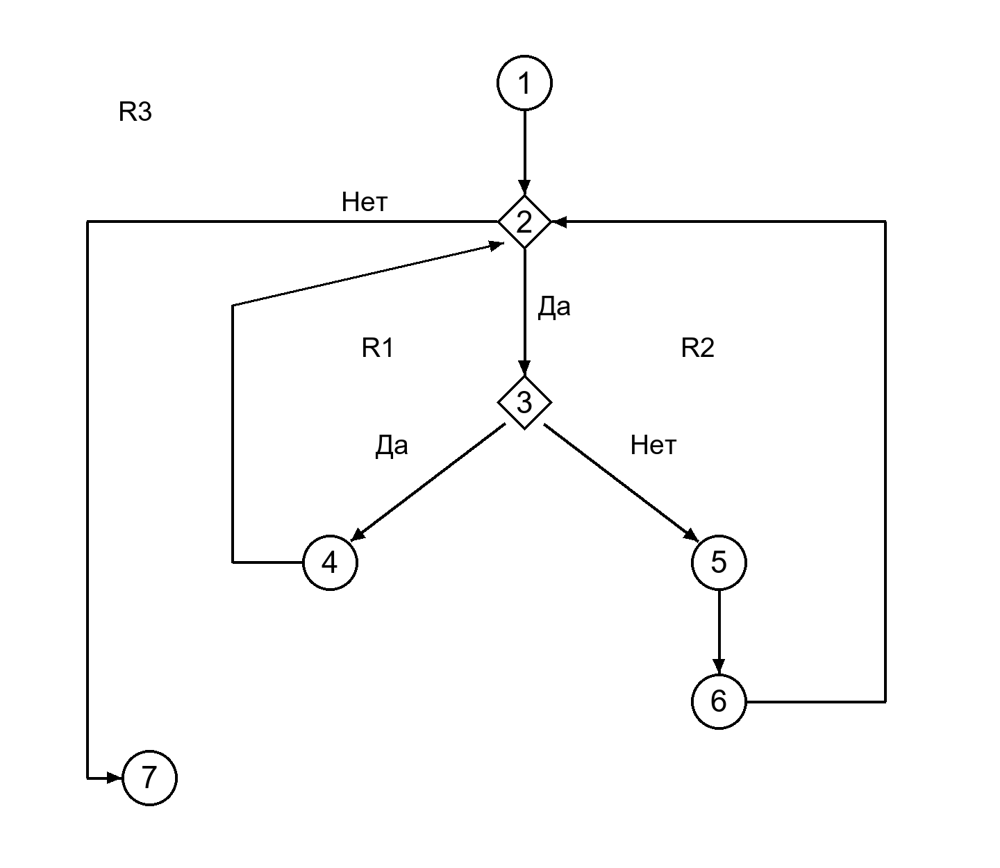

# Лабораторная работа 3. Вариант 3

Тема: структурное тестирование. Дата проверки упрощённой программы: 10.11.2026.

## Цель работы

Построить потоковый граф заданного фрагмента, вычислить цикломатическую сложность, выделить базовое множество путей и сравнить ответы программы с ожидаемыми.

## Задача и формула

Даны `n + 1` различных узлов `x[0] ... x[n]`, индекс `k` и точка `t`. Вычисляется один элементарный многочлен Лагранжа:

$$
L_k(t)=\prod_{i=0,\ i\ne k}^{n}\frac{t-x_i}{x_k-x_i}
$$

Знак произведения означает перемножение дробей для всех индексов, кроме `k`. При `i == k` знаменатель был бы равен нулю, поэтому этот индекс пропускается. Начальное `L = 1` не меняет первый множитель. При одном узле множителей нет, результат равен 1.

Для обычного вычисления вводятся корректные данные: `n >= 0`, `0 <= k <= n`, различные конечные узлы и конечная точка `t`. Как и фрагмент методички, метод вычисления предполагает выполнение этих условий. При `t = x[k]` ответ равен 1, а при `t = x[j]`, `j != k`, ответ равен 0.

## Устройство программы

Весь код находится в `Lab3/Program.cs`. Метод `Main` вводит `n`, узлы, `k`, `t` и выводит результат. Метод `Calculate` выполняет вычисление. Отдельных классов с примерами, записи маршрутов и режима JSON нет.

Вычислительный фрагмент соответствует варианту 3 методички. Для графа используются следующие номера:

```csharp
double L = 1.0;                    // 1
int i = 0;
while (i <= n)                    // 2
{
    if (i == k)                   // 3
    {
        ++i;                      // 4
        continue;
    }
    L *= (t - x[i]) / (x[k] - x[i]); // 5
    ++i;                          // 6
}
return L;                         // 7
```

`x`, `n`, `k`, `t` не меняются. Меняются накопленное произведение `L` и индекс `i`. Ввод узлов в `Main` не включён в рассматриваемый граф. Маршруты ниже получены пошаговым разбором кода.

## Потоковый граф



Вершины: 1 — инициализация; 2 — проверка цикла; 3 — проверка `i == k`; 4 — увеличение индекса и `continue`; 5 — умножение; 6 — увеличение индекса; 7 — возврат ответа.

Дуги: 1 → 2; 2 → 3; 2 → 7; 3 → 4; 3 → 5; 4 → 2; 5 → 6; 6 → 2.

## Цикломатическая сложность

В графе 7 вершин, 8 дуг и 2 предикатные вершины.

| Способ | Расчёт |
| --- | --- |
| По дугам и вершинам | V(G) = E − N + 2 = 8 − 7 + 2 = 3 |
| По условиям | V(G) = P + 1 = 2 + 1 = 3 |
| По областям | Две внутренние области и одна внешняя: 3 |

Результат относится к вычислительному фрагменту. Он задаёт размер базиса графа, а не количество всех возможных запусков.

## Базовое множество путей

P1: 1 → 2 → 7. Цикл не выполняется. При начальном `i = 0` это возможно только при `n < 0`. На допустимых данных путь недостижим. Отдельный тест S01 вызывает `Calculate` с пустым массивом и `n = -1`: ответ 1, обращений к массиву нет. Это структурный эксперимент вне математической области задачи.

P2: 1 → 2 → 3 → 4 → 2 → 7. Пример T01: `x = [3]`, `n = 0`, `k = 0`, `t = 100`. Единственный индекс пропущен, ответ 1. Относительно P1 добавлены дуги 2 → 3, 3 → 4, 4 → 2.

P3: 1 → 2 → 3 → 5 → 6 → 2 → 3 → 4 → 2 → 7. Пример T02: `x = [0; 2]`, `n = 1`, `k = 1`, `t = 1`. Сначала умножение на 0,5, затем пропуск индекса `k`. Ответ 0,5. Добавлены дуги 3 → 5, 5 → 6, 6 → 2.

Каждый следующий путь добавляет новые дуги. По разбору T02 уже проходит все восемь дуг и оба исхода каждого условия. Это не делает полный путь P1 достижимым при `n >= 0`.

## Примеры и результаты

Ответы получены запуском упрощённой программы от 10.11.2026. Абсолютный допуск сравнения — 10⁻¹².

| Тест | Узлы x | n | k | t | Ожидалось | Получено |
| --- | --- | --- | --- | --- | --- | --- |
| T01 | 3 | 0 | 0 | 100 | 1 | 1 |
| T02 | 0; 2 | 1 | 1 | 1 | 0,5 | 0,5 |
| T03 | 0; 2 | 1 | 0 | 1 | 0,5 | 0,5 |
| T04 | 0; 1; 2 | 2 | 1 | 1,5 | 0,75 | 0,75 |
| T05 | 0; 1; 2 | 2 | 1 | 1 | 1 | 1 |
| T06 | 0; 1; 2 | 2 | 1 | 0 | 0 | 0 |
| T07 | −2; 0; 2 | 2 | 1 | 3 | −1,25 | −1,25 |
| T08 | −1; 0; 2; 4 | 3 | 2 | 1 | 0,5 | 0,5 |

T01 проверяет один узел. В T02 умножение идёт до пропуска, в T03 — после него. T04 выполняет умножения с обеих сторон от пропуска. T05 и T06 проверяют значения в узлах. T07 даёт отрицательный ответ за пределами узлов. T08 использует четыре узла.

В T04 переменные меняются так:

```text
Начало: i = 0, L = 1.
i = 0: L = 1 * (1,5 - 0)/(1 - 0) = 1,5; i становится 1.
i = 1: i == k, умножение пропускается; L = 1,5; i становится 2.
i = 2: L = 1,5 * (1,5 - 2)/(1 - 2) = 0,75; i становится 3.
i = 3: условие 3 <= 2 ложно, выход; ответ 0,75.
```

Путь T04: 1 → 2 → 3 → 5 → 6 → 2 → 3 → 4 → 2 → 3 → 5 → 6 → 2 → 7.

Подробные шаги всех примеров приведены в [простом текстовом отчёте](Отчет_ЛР3_простой.txt).

## Проверка программы

Прошли 53 из 53 тестов решения. Для ЛР3 — 10: восемь примеров, S01 и проверка суммы базисных многочленов по всем `k`. Остальные 43 относятся к калькулятору.

Отдельно все восемь примеров выполнены через консоль. Ещё две проверки подтвердили дробный ввод с запятой в узлах и в точке `t`. Файлы результатов: [lab3-cases.json](Results/2026-11-10/lab3-cases.json), [lab3-cli.json](Results/2026-11-10/lab3-cli.json), [lab3.trx](Results/2026-11-10/lab3.trx).

Маршруты определены разбором кода; программа их не записывает. Вычисления используют `double`, поэтому промежуточные значения могут округляться. Успешные проверки не доказывают отсутствие всех ошибок.

## Запуск

```text
dotnet run --project Lab3/SoftwareTesting.Lab3.csproj
```

Для T04 вводить по одному значению с новой строки:

```text
2
0
1
2
1
1,5
```

Это `n = 2`, три узла `0, 1, 2`, индекс `k = 1` и точка `t = 1,5`. Ответ: `L = 0,75` или `L = 0.75` в зависимости от системного формата чисел. Ввод поддерживает оба разделителя дробной части.

Тесты: `dotnet test SoftwareTesting.sln`. В Visual Studio выбрать `SoftwareTesting.Lab3` запускаемым проектом.

## Ответы на контрольные вопросы

### 1 Понятие тестирования

Тестирование - процесс проверки программного обеспечения, включающий подготовку и выполнение проверок, оценку результатов и выявление расхождений с ожидаемым поведением. Успешный прогон выбранных тестов не доказывает отсутствие всех дефектов.

### 2 Тест и процесс тестирования

Тест задаёт входные данные, предусловия, действия и ожидаемый результат. Процесс включает анализ объекта, выбор проверок, подготовку среды, выполнение, сравнение результатов, регистрацию дефектов и повторную проверку исправлений.

### 3 Структурное тестирование

Это тестирование, при котором сценарии выбирают по внутренней структуре программы. Для управления потоком используют граф, условия, ветви и циклы; полноту оценивают по выбранному критерию покрытия.

### 4 Суть тестирования белого ящика

Тестировщик знает исходный код и подбирает данные для выполнения конкретных операторов и переходов. Проверяются внутренние элементы и их взаимодействие, а результаты сопоставляются с ожидаемыми.

### 5 Особенности белого ящика

Проверяют независимые пути, оба исхода решений и допустимые режимы циклов. При составных условиях учитывают порядок вычисления и короткое замыкание. Достижимость пути устанавливают по данным и состоянию программы.

### 6 Достоинства и недостатки

Метод позволяет находить ошибки ветвления, пропущенные переходы и ошибки работы циклов, а также измерять покрытие кода. Он требует доступа к реализации; число маршрутов может быть большим, а отсутствующую в коде функциональность или ошибку требований полное покрытие само по себе не выявляет.

## Ответы на контрольные вопросы продолжение

### 7 Стратегии белого ящика

Покрытие операторов требует выполнить каждый оператор. Покрытие решений - получить оба исхода каждого решения. Покрытие условий - получить истину и ложь для простых условий. Покрытие решений и условий объединяет эти проверки; комбинаторное покрытие рассматривает все достижимые сочетания условий. Метод базового пути выбирает структурно независимые маршруты.

### 8 Тестирование базового пути

По графу управления вычисляют цикломатическую сложность, выделяют базис независимых путей, подбирают данные и выполняют проверки. Нереализуемые пути отмечают с объяснением ограничений; их нельзя объявлять проверенными на допустимых данных.

### 9 Особенности потокового графа

Вершины соответствуют линейным участкам кода и условиям, ориентированные дуги - переходам управления. У простого предиката два исхода. Составное условие разбивают на простые проверки с учётом короткого замыкания. При подсчёте областей учитывают внешнюю область.

### 10 Цикломатическая сложность

Это количественная характеристика структуры управления и размер независимого базиса графа. Для связного графа с одним входом и выходом V(G) = E - N + 2; при бинарных предикатах также V(G) = P + 1. Для плоского изображения результат равен числу областей с внешней.

### 11 Базовое множество

Базовое множество состоит из независимых путей графа. В выбранном порядке каждый следующий путь содержит ранее не использованную дугу. В данной работе P1, P2 и P3 образуют структурный базис; P1 нельзя реализовать в математической области n ≥ 0.

### 12 Шаги метода базового пути

Пронумеровать участки исходного кода, построить граф, рассчитать сложность, выделить независимые пути и проверить их достижимость. Затем подобрать входные данные и ожидаемые результаты, выполнить тесты, сравнить фактическое поведение и оформить выводы.

### Вывод

Вычислительный цикл соответствует фрагменту варианта 3. Построен граф из 7 вершин и 8 дуг, цикломатическая сложность равна 3. Выделены три независимых пути; для P1 указана недостижимость при допустимом n. Ответы восьми примеров совпали с ожидаемыми.

### Источник

Тестирование ПО.pdf. Лабораторная работа 3: с. 12–29; вариант 3: с. 27; требования к отчёту и контрольные вопросы: с. 29.

PDF-отчёт и результаты от 03.11.2026 сохранены как описание прежней реализации. Текущий код и результаты от 10.11.2026 описаны в этом файле и простом текстовом отчёте.
